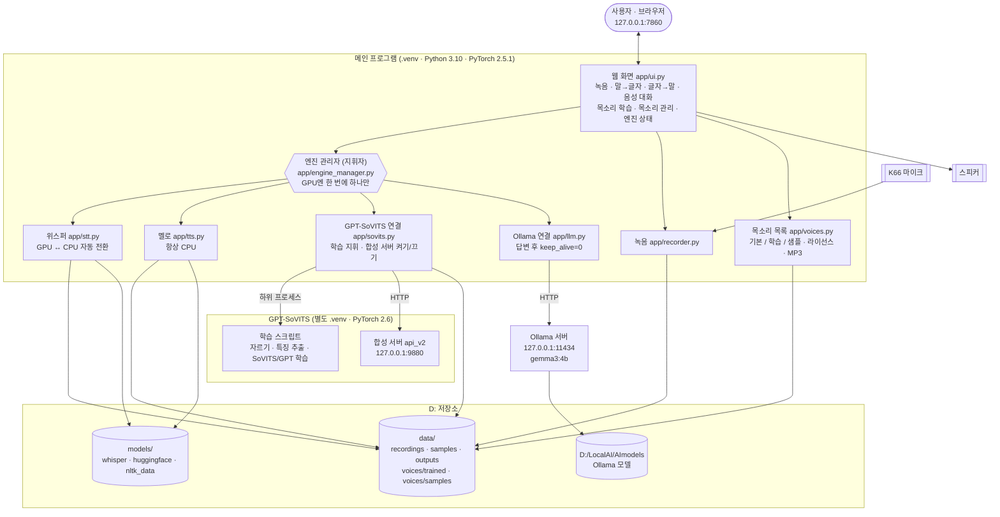
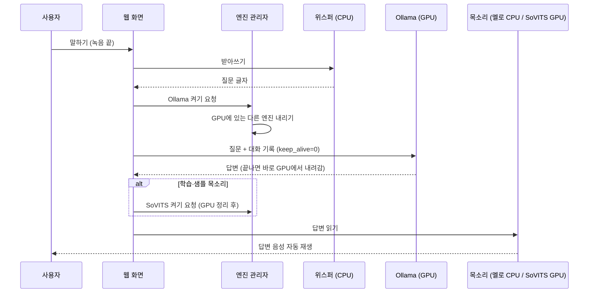
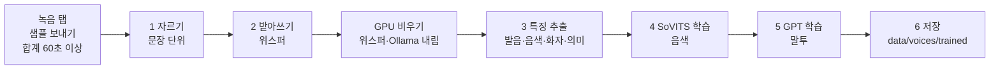

# VoiceStudio 구성도

## 1. 전체 구조

## 2. 음성 대화 한 번의 흐름

## 3. 목소리 학습 흐름

## 4. GPU(VRAM 6GB) 사용 규칙

| 엔진 | 위치 | 대략 VRAM | 언제 올라가나 |
|---|---|---|---|
| 위스퍼 small | GPU(여유 없으면 CPU) / 음성 대화 중엔 CPU | 약 1GB | 말→글자 변환 |
| 멜로 | 항상 CPU | 0 | 글자→말(기본 목소리) |
| GPT-SoVITS 합성 서버 | GPU | 약 2~3GB | 학습·샘플 목소리로 읽을 때 |
| GPT-SoVITS 학습 | GPU 독점 | 약 4~5GB | 학습 중 (다른 GPU 엔진 금지) |
| Ollama gemma3:4b | GPU | 약 4GB | 답변하는 동안만 |

GPU를 쓰는 엔진을 켜기 전에 엔진 관리자가 다른 GPU 엔진을 먼저 내립니다.
